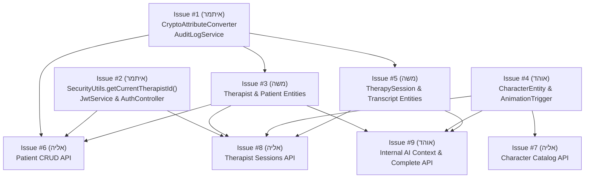

# AGENT_SYNC_CONTRACT.md – חוזה סנכרון מוחלט בין סוכני ה-AI של צוות 2 🤖🔗

> **הנחיה מחייבת לכל סוכן AI (Antigravity / Claude Code / Cursor / Copilot):**  
> קובץ זה הוא **"מקור האמת היחיד" (Single Source of Truth)** לחתימות המחלקות, המתודות, השדות וה-Repositories בין 9 ה-Issues של צוות 2.  
> מכיוון ש-4 מפתחים עובדים במקביל בענפים (Branches) נפרדים, **נאסר לחלוטין לשנות שמות מחלקות, שמות מתודות או טיפוסי פרמטרים** המופיעים בקובץ זה. כל חריגה תגרום לשבירת הקומפילציה בעת המיזוג ל-`main`!

---

## 1. מפת התלויות בין ה-Issues והסוכנים



---

## 2. חתימות מחייבות – Issue #1 (הצפנה ו-Audit Log – איתמר `@eitamr717`)

כל סוכן שמממש או צורך את Issue #1 **חייב** להשתמש בשמות ובחתימות הבאות בדיוק:

### 2.1 `com.therapy.coredataservice.crypto.CryptoAttributeConverter`
```java
package com.therapy.coredataservice.crypto;

import jakarta.persistence.AttributeConverter;
import jakarta.persistence.Converter;
import org.springframework.stereotype.Component;

@Component
@Converter
public class CryptoAttributeConverter implements AttributeConverter<String, String> {
    @Override
    public String convertToDatabaseColumn(String attribute); // מצפין ב-AES-256-GCM (מחזיר null אם הקלט null)

    @Override
    public String convertToEntityAttribute(String dbData);   // מפענח מ-Base64 (מחזיר null אם הקלט null)
}
```

### 2.2 `com.therapy.coredataservice.service.AuditLogService`
```java
package com.therapy.coredataservice.service;

import java.util.UUID;

public interface AuditLogService {
    void logAction(UUID therapistId, String action, String resourceType, String resourceId);
}
```
*(דוגמת קריאה מתוך `PatientService` או `SessionService`: `auditLogService.logAction(therapistId, "READ_PATIENT", "PATIENT", patientId.toString());`)*

---

## 3. חתימות מחייבות – Issue #2 (אבטחה וזיהוי המטפל המחובר – איתמר `@eitamr717`)

כדי שה-Controllers של **אליה** (Issues #6, #8) יוכלו לשלוף את ה-`therapistId` של המטפל המחובר מתוך ה-JWT בדרך אחידה:

### 3.1 `com.therapy.coredataservice.security.SecurityUtils`
```java
package com.therapy.coredataservice.security;

import java.util.UUID;

public final class SecurityUtils {
    /**
     * שולף את ה-UUID של המטפל המחובר מתוך ה-SecurityContextHolder.
     * זורק ForbiddenAccessException / AccessDeniedException אם אין משתמש מאומת.
     */
    public static UUID getCurrentTherapistId();
}
```

---

## 4. חתימות מחייבות – Issues #3, #4, #5 (Entities & Repositories – משה ואוהד)

> **חשוב:** אין להשתמש ב-Lombok אם הוא לא מוגדר ב-`pom.xml` – יש לכתוב Getters ו-Setters סטנדרטיים ב-Java כדי שכל הסוכנים יוכלו לקרוא להם ללא תלות בפלאגין של ה-IDE.

### 4.1 `com.therapy.coredataservice.entity.Therapist` (Issue #3 – משה)
* **שדות ו-Getters/Setters מדויקים:**
  * `UUID getId()` / `void setId(UUID id)`
  * `String getEmail()` / `void setEmail(String email)`
  * `String getPasswordHash()` / `void setPasswordHash(String passwordHash)`
  * `String getFullName()` / `void setFullName(String fullName)`
  * `String getSpecialty()` / `void setSpecialty(String specialty)`
  * `Instant getCreatedAt()` / `Instant getUpdatedAt()`
* **Repository (`com.therapy.coredataservice.repository.TherapistRepository`):**
  ```java
  public interface TherapistRepository extends JpaRepository<Therapist, UUID> {
      Optional<Therapist> findByEmail(String email);
      boolean existsByEmail(String email);
  }
  ```

### 4.2 `com.therapy.coredataservice.entity.Patient` (Issue #3 – משה)
* **שדות ו-Getters/Setters מדויקים:**
  * `UUID getId()` / `void setId(UUID id)`
  * `UUID getTherapistId()` / `void setTherapistId(UUID therapistId)`
  * `String getDisplayAlias()` / `void setDisplayAlias(String displayAlias)` *(מוצפן עם `@Convert(converter = CryptoAttributeConverter.class)`)*
  * `String getPersonalDetails()` / `void setPersonalDetails(String personalDetails)` *(מוצפן)*
  * `Integer getAge()` / `void setAge(Integer age)`
  * `String getEmotionalBackground()` / `void setEmotionalBackground(String emotionalBackground)` *(מוצפן)*
  * `String getInterestsAndSafeTopics()` / `void setInterestsAndSafeTopics(String interestsAndSafeTopics)` *(מוצפן)*
  * `String getLongTermGoals()` / `void setLongTermGoals(String longTermGoals)` *(מוצפן)*
  * `String getTherapistNotes()` / `void setTherapistNotes(String therapistNotes)` *(מוצפן)*
  * `List<String> getPreferredCharacterIds()` / `void setPreferredCharacterIds(List<String> preferredCharacterIds)`
  * `Instant getCreatedAt()` / `Instant getUpdatedAt()`
* **Repository (`com.therapy.coredataservice.repository.PatientRepository`):**
  ```java
  public interface PatientRepository extends JpaRepository<Patient, UUID> {
      List<Patient> findAllByTherapistIdOrderByCreatedAtDesc(UUID therapistId);
      Optional<Patient> findByIdAndTherapistId(UUID id, UUID therapistId);
  }
  ```

### 4.3 `CharacterEntity` ו-`AnimationTrigger` (Issue #4 – אוהד `@ohadjobs2`)
* **`com.therapy.coredataservice.entity.CharacterEntity`:**
  * `String getId()` / `void setId(String id)` (למשל `"char_astro"`)
  * `String getName()` / `void setName(String name)`
  * `String getDescription()` / `void setDescription(String description)`
  * `String getPersonalityProfilePrompt()` / `void setPersonalityProfilePrompt(String personalityProfilePrompt)`
  * `String getVoiceConfigId()` / `void setVoiceConfigId(String voiceConfigId)`
  * `String getUnityModelAssetId()` / `void setUnityModelAssetId(String unityModelAssetId)`
  * `String getAvatarUrl()` / `void setAvatarUrl(String avatarUrl)` (תמונה דו-ממדית Thumbnail עבור צוות 1)
  * `List<AnimationTrigger> getAvailableAnimations()` / `void setAvailableAnimations(List<AnimationTrigger> availableAnimations)`
* **`com.therapy.coredataservice.entity.AnimationTrigger`:**
  * `String getAnimationTriggerId()` / `void setAnimationTriggerId(String animationTriggerId)`
  * `String getDisplayName()` / `void setDisplayName(String displayName)`
  * `String getAiUsageDescription()` / `void setAiUsageDescription(String aiUsageDescription)`
* **Repositories:**
  ```java
  public interface CharacterRepository extends JpaRepository<CharacterEntity, String> {}
  public interface AnimationTriggerRepository extends JpaRepository<AnimationTrigger, String> {}
  ```

### 4.4 `TherapySession` ו-`TranscriptEntry` (Issue #5 – משה)
* **Enums בחבילה `com.therapy.coredataservice.entity`:**
  ```java
  public enum SessionStatus { CREATED, ACTIVE, COMPLETED }
  public enum SpeakerType { CHILD, CHARACTER, THERAPIST_STEERING }
  ```
* **`com.therapy.coredataservice.entity.TherapySession`:**
  * `UUID getId()` / `void setId(UUID id)`
  * `UUID getPatientId()` / `void setPatientId(UUID patientId)`
  * `UUID getTherapistId()` / `void setTherapistId(UUID therapistId)`
  * `String getCharacterId()` / `void setCharacterId(String characterId)`
  * `SessionStatus getStatus()` / `void setStatus(SessionStatus status)`
  * `String getSessionGoals()` / `void setSessionGoals(String sessionGoals)` *(מוצפן)*
  * `String getFocusTopics()` / `void setFocusTopics(String focusTopics)` *(מוצפן)*
  * `String getSensitiveBoundaries()` / `void setSensitiveBoundaries(String sensitiveBoundaries)` *(מוצפן)*
  * `Instant getStartedAt()` / `void setStartedAt(Instant startedAt)`
  * `Instant getEndedAt()` / `void setEndedAt(Instant endedAt)`
  * `Long getDurationSeconds()` / `void setDurationSeconds(Long durationSeconds)`
  * `String getTherapistSessionNotes()` / `void setTherapistSessionNotes(String therapistSessionNotes)` *(מוצפן)*
  * `String getAiSummary()` / `void setAiSummary(String aiSummary)` *(מוצפן)*
  * `List<TranscriptEntry> getTranscript()` / `void setTranscript(List<TranscriptEntry> transcript)`
* **`com.therapy.coredataservice.entity.TranscriptEntry`:**
  * `UUID getId()` / `void setId(UUID id)`
  * `Integer getSequenceNumber()` / `void setSequenceNumber(Integer sequenceNumber)`
  * `Instant getTimestamp()` / `void setTimestamp(Instant timestamp)`
  * `SpeakerType getSpeaker()` / `void setSpeaker(SpeakerType speaker)`
  * `String getContent()` / `void setContent(String content)` *(מוצפן)*
  * `String getTtsDirectives()` / `void setTtsDirectives(String ttsDirectives)`
  * `String getAnimationTriggerId()` / `void setAnimationTriggerId(String animationTriggerId)`
* **Repository (`com.therapy.coredataservice.repository.TherapySessionRepository`):**
  ```java
  public interface TherapySessionRepository extends JpaRepository<TherapySession, UUID> {
      List<TherapySession> findAllByPatientIdAndTherapistIdOrderByStartedAtDesc(UUID patientId, UUID therapistId);
      Optional<TherapySession> findByIdAndTherapistId(UUID id, UUID therapistId);
  }
  ```

---

## 5. מחלקות חריגים משותפות (`com.therapy.coredataservice.exception`)
כל הסוכנים ישתמשו ב-2 מחלקות החריגים הבאות עבור משאבים חסרים או גישה לא מורשית:
* `ResourceNotFoundException extends RuntimeException` (מומרת ל-`404 Not Found`)
* `ForbiddenAccessException extends RuntimeException` (מומרת ל-`403 Forbidden`)

---

## 6. הוראה לסוכן של כל מפתח בעת עבודה על Issue
1. **אל תיצור מחלקות ששייכות ל-Issue של מפתח אחר** – למעט אם הענף שלו טרם מוזג ל-`main` ואתה זקוק לחתימת הממשק/מחלקה כדי שהקוד שלך יתקמפל. במקרה כזה, צור Stub מינימלי עם החתימה המדויקת מתוך קובץ זה בלבד!
2. ודא שכל שמות השדות ב-DTOs תואמים אות-באות למבני ה-JSON ב-[`docs/TEAM2_SPEC.md`](TEAM2_SPEC.md).
3. לפני פתיחת Pull Request, הרץ `mvn test` וודא שאפס שגיאות קומפילציה או טסטים קיימות בענף שלך.
