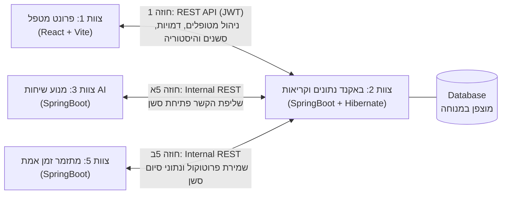
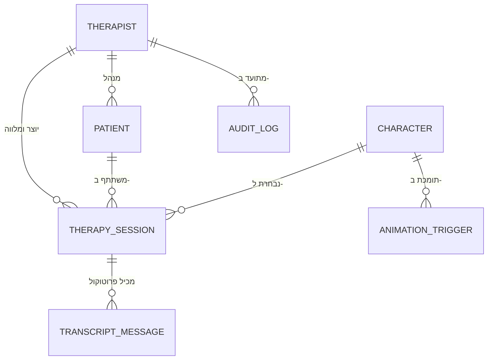

# מסמך אפיון מערכת מורחב – צוות 2: באקנד נתונים וקריאות (Core CRUD & Data Service)

**פרויקט:** פלטפורמה לסיוע בטיפול רגשי בילדים באמצעות דמות אנימציה אינטראקטיבית  
**צוות אחראי:** צוות 2 – יוסי גלר (מנהל צוות), איתמר אהרונוב, משה אנידג'ר, אוהד סבג, אליה גבאי  
**סטאק טכנולוגי:** Java SpringBoot, Hibernate (JPA), Spring Security (JWT), מסד נתונים רלציוני (PostgreSQL)

---

## 1. תמצית תפקיד הצוות וגבולות גזרה

צוות 2 מהווה את **"שומר הסף"** של מידע המערכת. השירות אחראי על ניהול כלל שכבת הנתונים הקבועה (Persistent Data), אכיפת הרשאות ואימות משתמשים, הצפנת מידע רפואי ואישי רגיש של קטינים, ומתן שירותי נתונים (REST APIs) לשאר רכיבי המערכת.



---

## 2. מטרות המערכת ותכולת העבודה של צוות 2

בהתאם למסמך האפיון הממוקד ולמסמך חלוקת העבודה, המערכת של צוות 2 מורכבת מ-4 מודולים מרכזיים:

### 2.1 ניהול משתמשים והרשאות (RBAC)
* **אימות מטפלים (Authentication):** התחברות מאובטחת של מטפלים לממשק הניהול (Back Office) באמצעות JWT, וניהול פרופיל המטפל.
* **הפרדת הרשאות מוחלטת (Authorization):**
  * **מטפל (`ROLE_THERAPIST`):** גישה מלאה לממשק הניהול – ניהול כרטיסי המטופלים המשויכים אליו בלבד, הגדרת סשנים וצפייה בהיסטוריית המפגשים.
  * **ילד / מטופל (`ROLE_CHILD_SESSION`):** גישה מבודדת לחלוטין למסך השיחה האינטראקטיבי בלבד (מול צוות 5). לממשק הילד (Unity) **אין גישה כלל** ל-Endpoints של מידע טיפולי, הגדרות מערכת או תיעוד היסטורי בצוות 2.

### 2.2 ניהול ואבטחת מאגר המטופלים (Patient Management)
מימוש לוגיקת CRUD מלאה עבור כרטיס מטופל ייעודי. כל כרטיס מטופל משויך למטפל האחראי ומרכז את הנתונים הבאים:
1. **פרטים אישיים בסיסיים** (שם, גיל/תאריך לידה).
2. **רקע רגשי, אתגרים וקשיים מרכזיים** (מידע רפואי ורגשי רלוונטי).
3. **תחומי עניין ונושאים המשרים ביטחון** (העדפות אישיות ונושאים בטוחים לשיחה).
4. **מטרות טיפוליות ארוכות טווח**.
5. **הערות שוטפות של המטפל**.
6. **דמויות אנימציה מועדפות** (שיוך לקטלוג הדמויות).

### 2.3 ניהול קטלוג דמויות ואנימציות (Character & Animation Catalog)
שמירה וניהול של מאגר הדמויות הקבועות במערכת ובנק האנימציות שלהן:
* **פרופיל דמות:** מזהה דמות, שם הדמות, פרופיל אישיות מוגדר ומובנה (אופי, אוצר מילים מותאם לילדים, חום, אמפתיה, ביטויים ייחודיים / Catchphrases), מזהה מודל תלת-ממדי (עבור Unity - צוות 4) ומזהה קול (עבור ה-TTS - צוות 5).
* **בנק אנימציות מוגדר מראש (Animation IDs):** מאגר סגור של מזהי אנימציות מוכנות (כגון: דיבור/תנועת שפתיים, נפנוף לשלום, הקשבה, חשיבה, מחיאת כף, חיבוק, שילוב ידיים והבעות נלוות). כל אנימציה כוללת מזהה טכני (`animationTriggerId`) ותיאור סמנטי של המשמעות שלה, כדי שמנוע ה-AI (צוות 3) יוכל לבחור את הטריגר המתאים לתוכן התשובה.

### 2.4 ניהול סשנים, תיעוד וארכוב היסטוריית שיחה (Session Management & Archiving)
* **פתיחת סשן חדש:** קליטת הגדרות המפגש מהמטפל לפני תחילת השיחה:
  * בחירת המטופל והדמות למפגש.
  * מטרות המפגש הנוכחי.
  * נושאים למיקוד ושאלות שהדמות צריכה להעלות (ואופי השיחה הרצוי).
  * גבולות ונושאים רגישים שיש להימנע מהם.
* **סיום סשן וארכוב:** שמירת נתוני הסשן שהסתיים (תאריך, שעת התחלה/סיום, משך המפגש), **תמליל השיחה המלא מילה-במילה (פרוטוקול שיחה)** שהתקבל מזמן האמת, וסיכום/הערות ידניות שהוזנו על ידי המטפל.
* **ממשק היסטוריית שיחה:** שליפה כרונולוגית של כלל המפגשים הקודמים של מטופל, כולל צפייה מלאה בפרוטוקול השיחה ועדכון הערות מטפל.

---

## 3. סכמת מסד הנתונים וישויות Hibernate (JPA Entities)



### 3.1 טבלת מטפלים (`therapists`)
| שם שדה | טיפוס (Java / DB) | תיאור | הערות אבטחה |
| :--- | :--- | :--- | :--- |
| `id` | `UUID` (PK) | מזהה ייחודי של המטפל | |
| `email` | `String` (`VARCHAR`, Unique) | כתובת אימייל להתחברות | אינדקס חיפוש |
| `passwordHash` | `String` (`VARCHAR`) | סיסמה מוצפנת | `BCryptPasswordEncoder` |
| `fullName` | `String` (`VARCHAR`) | שם מלא של המטפל | |
| `specialty` | `String` (`TEXT`) | תחומי התמחות ושיטות טיפול | אופציונלי (פרופיל מטפל) |
| `therapeuticPreferences` | `String` (`TEXT`) | העדפות טיפוליות ועקרונות מנחים | אופציונלי |
| `createdAt` / `updatedAt` | `Instant` (`TIMESTAMP`) | חותמות זמן | |

### 3.2 טבלת מטופלים (`patients`)
> [!IMPORTANT]
> כל השדות המסומנים כ-**מוצפן (AES-256)** עוברים הצפנה ופיענוח שקופים בשכבת ה-Hibernate באמצעות `@Convert(converter = CryptoAttributeConverter.class)` לפני שמירתם ב-DB.

| שם שדה | טיפוס (Java / DB) | תיאור | הערות אבטחה |
| :--- | :--- | :--- | :--- |
| `id` | `UUID` (PK) | מזהה פנימי של המטופל | |
| `therapistId` | `UUID` (FK -> `therapists.id`) | המטפל האחראי על הילד | חובת סינון בכל שאילתה |
| `displayAlias` | `String` (`VARCHAR`) | שם פרטי / כינוי לשימוש בשיחה | **מוצפן (AES-256)** |
| `personalDetails` | `String` (`TEXT`) | פרטים אישיים בסיסיים (שם מלא, גיל, רקע כללי) | **מוצפן (AES-256)** – לא נשלח ל-AI! |
| `age` | `Integer` (`INT`) | גיל הילד (להתאמת שפת הדמות) | |
| `emotionalBackground` | `String` (`TEXT`) | רקע רגשי, אתגרים וקשיים מרכזיים | **מוצפן (AES-256)** |
| `interestsAndSafeTopics` | `String` (`TEXT`) | תחומי עניין ונושאים המשרים ביטחון | **מוצפן (AES-256)** |
| `longTermGoals` | `String` (`TEXT`) | מטרות טיפוליות ארוכות טווח | **מוצפן (AES-256)** |
| `therapistNotes` | `String` (`TEXT`) | הערות שוטפות של המטפל | **מוצפן (AES-256)** |
| `preferredCharacterIds` | `List<String>` | רשימת מזהי דמויות מועדפות | |
| `createdAt` / `updatedAt` | `Instant` (`TIMESTAMP`) | חותמות זמן | |

### 3.3 טבלת קטלוג דמויות (`characters`) וטבלת אנימציות (`character_animations`)
| שם שדה | טיפוס (Java / DB) | תיאור |
| :--- | :--- | :--- |
| `id` | `String` (PK, למשל `"char_leo"`) | מזהה קבוע של הדמות |
| `name` | `String` (`VARCHAR`) | שם הדמות המוצג למטפל |
| `description` | `String` (`TEXT`) | תיאור הדמות למטפל |
| `personalityProfilePrompt` | `String` (`TEXT`) | פרופיל אישיות מובנה (אופי, טון דיבור, אוצר מילים, ביטויים ייחודיים) עבור ה-AI |
| `voiceConfigId` | `String` (`VARCHAR`) | מזהה הקול עבור מודל ה-TTS (צוות 5) |
| `unityModelAssetId` | `String` (`VARCHAR`) | מזהה המודל התלת-ממדי ב-Unity (צוות 4) |
| `avatarUrl` | `String` (`VARCHAR`, nullable) | כתובת תמונה דו-ממדית (Thumbnail) של הדמות עבור ממשק המטפל (צוות 1) |
| `animations` | `OneToMany` -> `AnimationTrigger` | רשימת האנימציות הזמינות לדמות זו |

**מבנה ישות `AnimationTrigger` (`character_animations`):**
* `animationTriggerId` (`String`, PK, למשל: `"IDLE_LISTEN"`, `"WAVE_HELLO"`, `"THINKING"`, `"CLAP_HAPPY"`, `"EMPATHIC_NOD"`, `"HUG_GESTURE"`).
* `displayName` (`String` – שם בעברית, למשל "נפנוף לשלום").
* `aiUsageDescription` (`String` – הוראה למנוע ה-AI מתי לבחור באנימציה זו).

### 3.4 טבלת סשנים טיפוליים (`therapy_sessions`) וטבלת תמליל (`session_transcript_entries`)
| שם שדה | טיפוס (Java / DB) | תיאור | הערות אבטחה |
| :--- | :--- | :--- | :--- |
| `id` | `UUID` (PK) | מזהה הסשן | משמש לסנכרון בין צוותים 1, 2, 3, 5 |
| `patientId` | `UUID` (FK -> `patients.id`) | המטופל שבסשן | |
| `therapistId` | `UUID` (FK -> `therapists.id`) | המטפל האחראי | |
| `characterId` | `String` (FK -> `characters.id`) | הדמות שנבחרה לסשן | |
| `status` | `Enum` (`CREATED`, `ACTIVE`, `COMPLETED`) | סטטוס המפגש | |
| `sessionGoals` | `String` (`TEXT`) | מטרות המפגש שהוגדרו בפתיחה | **מוצפן (AES-256)** |
| `focusTopics` | `String` (`TEXT`) | נושאים למיקוד ואופי השיחה | **מוצפן (AES-256)** |
| `sensitiveBoundaries` | `String` (`TEXT`) | גבולות ונושאים רגישים להימנע מהם | **מוצפן (AES-256)** |
| `startedAt` / `endedAt` | `Instant` (`TIMESTAMP`) | זמן התחלה וסיום | |
| `durationSeconds` | `Long` (`BIGINT`) | משך המפגש בשניות | |
| `therapistSessionNotes` | `String` (`TEXT`) | הערות ידניות של המטפל על הסשן | **מוצפן (AES-256)** |
| `aiSummary` | `String` (`TEXT`, Nullable) | סיכום אוטומטי (אופציונלי) | **מוצפן (AES-256)** |

**מבנה שורת פרוטוקול (`session_transcript_entries`):**
* `id` (`UUID`), `sessionId` (`UUID` FK)
* `sequenceNumber` (`Integer` – סדר כרונולוגי של המשפט בשיחה)
* `timestamp` (`Instant`)
* `speaker` (`Enum`: `CHILD`, `CHARACTER`, `THERAPIST_STEERING`)
* `content` (`String` – **מוצפן AES-256**: התוכן המילולי שנאמר או הנחיית המטפל)
* `ttsDirectives` (`String`, Nullable – הטון שנבחר, למשל `"אמפתי, רגוע"`)
* `animationTriggerId` (`String`, Nullable – האנימציה שהופעלה באותה תגובה)

---

## 4. אבטחת מידע, פרטיות והגנה על נתונים מול ה-AI (סעיף 7 באפיון)

1. **הצפנה במנוחה (Encryption at Rest) ובהעברה (In Transit):**
   * כל התקשורת מול השרת מתבצעת מעל HTTPS/TLS.
   * שדות רפואיים, רגשיים, הערות מטפל ותמלילי שיחות מוצפנים ב-AES-256-GCM ברמת האפליקציה (Hibernate Attribute Converter) לפני הכתיבה למסד הנתונים. המפתח מנוהל כמשתנה סביבה (`DATA_ENCRYPTION_KEY`) מחוץ לקוד.
2. **שיתוף נתונים רגישים ומזהים עם מודל ה-AI ("כמו שנאמר בשיעור"):**
   * **עקרון הפרדת ה-PII (מידע מזהה אישית):** מודל השפה החיצוני (LLM) לעולם לא צריך לדעת את שם המשפחה של הילד, מספר ת"ז, כתובת מגורים, שמות הורים או פרטים מזהים מהתיק הרפואי.
   * **סינון בשכבת צוות 2 (Data Minimization):** כאשר צוות 3 מבקש מצוות 2 את נתוני הרקע לפתיחת סשן (בחוזה 5), ה-DTO שמחזיר צוות 2 (`SessionAiContextResponse`) **משמיט לחלוטין** את השדה `personalDetails` ואת הערות המטפל הפרטיות (`therapistNotes`), ומעביר **אך ורק**:
     * כינוי/שם פרטי בלבד (`displayAlias`) וגיל (`age`).
     * רקע רגשי ואתגרים, תחומי עניין משרים ביטחון, ומטרות טיפוליות (לאחר סינון/התממה של מזהים).
3. **בידוד נתונים בין מטפלים (Tenant Isolation):**
   * כל Endpoint של צוות 1 שולף את ה-`therapistId` מתוך ה-JWT המאומת בלבד (לעולם לא מתוך ה-Request Body), ומוודא שהמטופל או הסשן המבוקשים שייכים לאותו מטפל (`findByIdAndTherapistId`).
4. **תיעוד גישה (Audit Logging):**
   * כל קריאה או עריכה של כרטיס מטופל או פרוטוקול שיחה נרשמת בטבלת `audit_logs` (`timestamp`, `therapistId`, `action`, `resourceType`, `resourceId`).

---

## 5. חוזי תקשורת וממשקים בין הצוותים (API Contracts)

זהו החלק שעליו יש לקבל אישור ("Sign-off") ממנהלי הצוותים שמתממשקים לצוות 2:
* **צוות 1 (פרונט מטפל):** אוראל מזרחי
* **צוות 3 (באקנד ניהול שיחות AI):** יחיאל
* **צוות 5 (מתזמר זמן אמת, קול ואנימציה):** אביאל ספיר

---

### חוזה 1: ממשק מטפל (צוות 1) מול באקנד נתונים (צוות 2) – REST API

**כותרת אבטחה נדרשת בכל הקריאות (מלבד Login):**  
`Authorization: Bearer <jwt_token>`

#### 1.1 אימות ופרופיל מטפל
* **`POST /api/v1/auth/login`**
  * **Request:** `{ "email": "therapist@clinic.co.il", "password": "..." }`
  * **Response (`200 OK`):**
    ```json
    {
      "accessToken": "eyJhbGciOiJIUzI1NiIs...",
      "tokenType": "Bearer",
      "expiresIn": 3600,
      "therapist": {
        "id": "a1b2c3d4-...",
        "fullName": "ד\"ר רונית לוי",
        "email": "therapist@clinic.co.il",
        "specialty": "חרדה חברתית וקשיי ויסות"
      }
    }
    ```
* **`GET /api/v1/therapists/me`** / **`PUT /api/v1/therapists/me`** – שליפה ועדכון של פרופיל המטפל המחובר.

#### 1.2 ניהול כרטיסי מטופלים (Patients CRUD)
* **`GET /api/v1/patients`** – החזרת רשימת המטופלים של המטפל המחובר (תצוגת תקציר: `id`, `displayAlias`, `age`, `lastSessionDate`).
* **`POST /api/v1/patients`** – יצירת כרטיס מטופל חדש.
* **`GET /api/v1/patients/{patientId}`** – שליפת כרטיס מטופל מלא.
* **`PUT /api/v1/patients/{patientId}`** – עדכון כרטיס מטופל (כולל עדכון הערות שוטפות של המטפל).
  * **מבנה JSON של כרטיס מטופל (Request / Response):**
    ```json
    {
      "id": "c9f8e7d6-...",
      "displayAlias": "נועם",
      "personalDetails": "נועם כהן, כיתה ג', הופנה עקב קושי בהשתלבות חברתית",
      "age": 8,
      "emotionalBackground": "חרדה חברתית, נטייה להימנעות ממשחקים קבוצתיים בהפסקה",
      "interestsAndSafeTopics": "חלל ואסטרונאוטים, לגו, כלבים",
      "longTermGoals": "חיזוק תחושת המסוגלות החברתית ושיתוף רגשות תסכול",
      "therapistNotes": "מגיב מצוין להומור עדין; נלחץ משאלות ישירות על ציונים.",
      "preferredCharacterIds": ["char_astro", "char_rex"]
    }
    ```

#### 1.3 שליפת קטלוג דמויות ואנימציות
* **`GET /api/v1/characters`** – שליפת רשימת הדמויות הזמינות במערכת (עבור מסך בחירת דמות בפתיחת סשן).
  * **Response (`200 OK`):**
    ```json
    [
      {
        "id": "char_astro",
        "name": "אסטרו החוקר מהחלל",
        "description": "דמות סקרנית, חמה ומעודדת המדברת בשפה מותאמת לילדים",
        "unityModelAssetId": "Astro3DModel",
        "avatarUrl": "https://cdn.example.com/characters/char_astro.png",
        "availableAnimations": [
          { "animationTriggerId": "WAVE_HELLO", "displayName": "נפנוף לשלום" },
          { "animationTriggerId": "IDLE_LISTEN", "displayName": "הקשבה" },
          { "animationTriggerId": "THINKING", "displayName": "חשיבה" },
          { "animationTriggerId": "CLAP_HAPPY", "displayName": "מחיאת כף" }
        ]
      }
    ]
    ```

#### 1.4 ניהול סשנים והיסטוריית מפגשים
* **`POST /api/v1/sessions`** – פתיחת סשן חדש (לפני תחילת השיחה עם הילד).
  * **Request:**
    ```json
    {
      "patientId": "c9f8e7d6-...",
      "characterId": "char_astro",
      "sessionGoals": "לעודד את נועם לשתף חוויה אחת מההפסקה בבית הספר",
      "focusTopics": "משחקים משותפים בהפסקה, איך מבקשים להצטרף למשחק, אופי שיחה משחקי ורגוע",
      "sensitiveBoundaries": "להימנע משאלות על אבא או על מעבר הדירה האחרון"
    }
    ```
  * **Response (`201 Created`):** מחזיר את אובייקט הסשן כולל `sessionId` (UUID) וסטטוס `"CREATED"`, שאיתו צוות 1 פותח את מסך הבקרה החי מול צוות 5.
* **`GET /api/v1/patients/{patientId}/sessions`** – שליפה כרונולוגית של היסטוריית המפגשים של המטופל (תאריך, משך, מטרות שהוגדרו, דמות שנבחרה, הערות מטפל).
* **`GET /api/v1/sessions/{sessionId}`** – שליפת פרטי סשן מלאים, כולל **תמליל השיחה המלא מילה-במילה (`transcript`)** והערות המטפל.
* **`PATCH /api/v1/sessions/{sessionId}/notes`** – הוספה או עדכון של הערות ידניות של המטפל על הסשן (`{ "therapistSessionNotes": "..." }`).
* **`POST /api/v1/sessions/{sessionId}/steering`** – שליחת הנחיית זמן אמת מהמטפל לדמות (Live Steering). צוות 2 מאמת בעלות מטפל על הסשן, מתעד את ההנחיה ומעביר אותה מיד למנוע ה-AI (צוות 3).
  * **Request:**
    ```json
    {
      "instruction": "תעודד את נועם לשתף איך הוא הרגיש בהפסקה",
      "desiredTone": "חם, מרגיע",
      "suggestedAnimationTriggerId": "EMPATHIC_NOD"
    }
    ```
    *(השדות `desiredTone` ו-`suggestedAnimationTriggerId` אופציונליים).*
  * **Response (`200 OK`):** `{ "sessionId": "77a1b2c3-...", "status": "FORWARDED", "forwardedAt": "..." }`.
* **`POST /api/v1/sessions/{sessionId}/end`** – סיום סשן יזום ע"י המטפל: מאמת בעלות מטפל, מעדכן את סטטוס הסשן ל-`COMPLETED` (כולל `endedAt` ו-`durationSeconds`), מעדכן את צוות 3 / צוות 5 לסיים את השיחה, ומחזיר את אובייקט הסשן המעודכן.

---

### חוזה 5: מנוע שיחות AI (צוות 3) ומתזמר זמן אמת (צוות 5) מול באקנד נתונים (צוות 2) – Internal REST API

נקודות קצה פנימיות לתקשורת שרת-לשרת (מוגנות באמצעות Header פנימי `X-Internal-Service-Key`).

#### 5.1 שליפת הקשר מלא לפתיחת סשן (קריאה של צוות 3 ו/או צוות 5 לצוות 2)
* **`GET /internal/api/v1/sessions/{sessionId}/context`**
* **מתי נקרא:** ברגע שהסשן מתחיל, צוות 3 שולף בבקשה אחת את כל שכבות המידע הנדרשות להרכבת ה-System Prompt הדינמי (אישיות הדמות + בנק האנימציות, רקע המטופל ללא פרטים מזהים, והנחיות הפתיחה של המטפל לאותו סשן).
* **Response (`200 OK`):**
  ```json
  {
    "sessionId": "77a1b2c3-...",
    "status": "ACTIVE",
    "character": {
      "id": "char_astro",
      "name": "אסטרו החוקר מהחלל",
      "voiceConfigId": "voice_astro_he_01",
      "unityModelAssetId": "Astro3DModel",
      "personalityProfilePrompt": "אתה אסטרו, חבר סקרן, חם ואמפתי. דבר במשפטים קצרים וברורים המותאמים לילד בן 8...",
      "availableAnimations": [
        {
          "animationTriggerId": "WAVE_HELLO",
          "aiUsageDescription": "השתמש בתחילת שיחה או בפרידה מהילד"
        },
        {
          "animationTriggerId": "IDLE_LISTEN",
          "aiUsageDescription": "השתמש כאשר הדמות מקשיבה או שואלת שאלה רגועה"
        },
        {
          "animationTriggerId": "THINKING",
          "aiUsageDescription": "השתמש כאשר הדמות מהרהרת או מתלבטת יחד עם הילד"
        },
        {
          "animationTriggerId": "CLAP_HAPPY",
          "aiUsageDescription": "השתמש לשמחה, התלהבות וחיזוק חיובי לילד"
        }
      ]
    },
    "patientContext": {
      "displayAlias": "נועם",
      "age": 8,
      "emotionalBackground": "חרדה חברתית, נטייה להימנעות ממשחקים קבוצתיים בהפסקה",
      "interestsAndSafeTopics": "חלל ואסטרונאוטים, לגו, כלבים",
      "longTermGoals": "חיזוק תחושת המסוגלות החברתית ושיתוף רגשות תסכול"
    },
    "sessionDirectives": {
      "sessionGoals": "לעודד את נועם לשתף חוויה אחת מההפסקה בבית הספר",
      "focusTopics": "משחקים משותפים בהפסקה, איך מבקשים להצטרף למשחק, אופי שיחה משחקי ורגוע",
      "sensitiveBoundaries": "להימנע משאלות על אבא או על מעבר הדירה האחרון"
    }
  }
  ```

#### 5.2 שמירת פרוטוקול השיחה ונתוני הסשן בסיום המפגש (קריאה של צוות 5 / צוות 3 לצוות 2)
* **`POST /internal/api/v1/sessions/{sessionId}/complete`**
* **מתי נקרא:** עם סיום המפגש הפעיל, לשמירת תמליל השיחה המלא מילה-במילה (פרוטוקול) ונתוני הסשן במסד הנתונים הקבוע.
* **Request:**
  ```json
  {
    "startedAt": "2026-11-10T16:00:00Z",
    "endedAt": "2026-11-10T16:20:30Z",
    "durationSeconds": 1230,
    "aiSummary": null,
    "transcript": [
      {
        "sequenceNumber": 1,
        "timestamp": "2026-11-10T16:00:05Z",
        "speaker": "CHARACTER",
        "content": "היי נועם! איזה כיף שנפגשנו היום! תגיד, ראית איזה כוכב מעניין השבוע?",
        "ttsDirectives": "שמח, נלהב",
        "animationTriggerId": "WAVE_HELLO"
      },
      {
        "sequenceNumber": 2,
        "timestamp": "2026-11-10T16:00:19Z",
        "speaker": "CHILD",
        "content": "לא ראיתי כוכבים, אבל בניתי חללית חדשה מלגו.",
        "ttsDirectives": null,
        "animationTriggerId": null
      },
      {
        "sequenceNumber": 3,
        "timestamp": "2026-11-10T16:00:25Z",
        "speaker": "THERAPIST_STEERING",
        "content": "תחמיא לו על החללית ואז תשאל אם הוא סיפר עליה למישהו מהכיתה בהפסקה",
        "ttsDirectives": null,
        "animationTriggerId": null
      }
    ]
  }
  ```
* **Response (`200 OK` – ACK):** `{ "sessionId": "77a1b2c3-...", "status": "COMPLETED", "savedTranscriptCount": 3 }`
* **Idempotency וטיפול ב-Retry / סיום מפגש (`/end`):**
  * השמירה מזוהה באמצעות סימון מפורש (`transcriptArchived`) ו-Hash של התוכן (`transcriptPayloadHash`), ולא רק לפי רשימה ריקה.
  * אם הסשן כבר עבר ל-`COMPLETED` בעקבות `POST /api/v1/sessions/{sessionId}/end` אך `transcriptArchived == false` – הקריאה שומרת את התמליל ומחזירה `200 OK` (ACK).
  * במקרה של **Retry עם אותו תוכן שכבר נשמר** (`transcriptArchived == true` ו-Hash תואם) – מחזיר **`200 OK`** (ACK) ללא שכפול.
  * במקרה של שליחת **תמליל שונה** לסשן שכבר נשמר (`transcriptArchived == true` ו-Hash שונה) – מחזיר **`409 Conflict`**.

#### 5.3 התראות יוצאות מצוות 2 לצוות 3 (Live Steering וסיום מפגש)
כל קריאה יוצאת מצוות 2 לצוות 3 מתבצעת ב-HTTPS עם Header פנימי ייעודי `X-Internal-Service-Key` (ממשתנה סביבה `TEAM3_INTERNAL_API_KEY`, לעולם לא בקוד):

1. **העברת הנחיית זמן אמת (`Live Steering`):**
   * `POST {AI_SERVICE_BASE_URL}/internal/api/v1/sessions/{sessionId}/steering`
   * **Request JSON:**
     ```json
     {
       "eventId": "550e8400-e29b-41d4-a716-446655440001",
       "instruction": "לעודד את הילד לדבר על הרגשות שלו",
       "desiredTone": "calm",
       "suggestedAnimationTriggerId": "EMPATHIC_NOD",
       "issuedAt": "2026-11-25T20:00:00Z"
     }
     ```
     *(`eventId` הוא UUID ייחודי שצוות 2 יוצר עבור Idempotency; `instruction` חובה; `desiredTone` ו-`suggestedAnimationTriggerId` אופציונליים).*
   * **תגובה מצופה מצוות 3:** `200 OK`.

2. **התראת סיום מפגש (`End Session Notification`):**
   * `POST {AI_SERVICE_BASE_URL}/internal/api/v1/sessions/{sessionId}/end`
   * **Request JSON:**
     ```json
     {
       "eventId": "550e8400-e29b-41d4-a716-446655440002",
       "startedAt": "2026-11-25T19:30:00Z",
       "endedAt": "2026-11-25T20:00:00Z",
       "durationSeconds": 1800
     }
     ```
     *(צוות 2 מעביר את הזמנים הרשמיים של הסשן כדי שצוות 3 יוכל להשתמש בהם בשליחת `POST /complete`).*
   * **תגובה מצופה מצוות 3:** `202 Accepted` (לאחר מכן צוות 3 מקפיא את התמליל ושולח `POST /internal/api/v1/sessions/{sessionId}/complete`).

---

## 6. חלוקת עבודה פנימית בצוות 2 (5 מפתחים)

בהתאם להמלצה במסמך חלוקת העבודה, העבודה בצוות מחולקת ל-3 שכבות ליבה במקביל:

| תחום אחריות | חברי צוות מוצעים | תכולת משימות מרכזית |
| :--- | :--- | :--- |
| **ניהול צוות, ארכיטקטורה, חוזי API ו-Code Review (ראש צוות)** | **יוסי גלר (מנהל צוות)** | • הובלת הארכיטקטורה, הקמת תשתית הפרויקט והגדרת הסוכנים (`AGENTS.md`).<br>• סגירת ותיאום חוזי ה-API (חוזה 1 וחוזה 5) מול ראשי צוותים 1, 3, 4 ו-5.<br>• ניהול ה-Issues, מעבר ואישור Pull Requests (Code Review) ואינטגרציה מערכתית. |
| **1. שכבת ה-Controllers & Services (חוזה 1 + חוזה 5)** | **אליה גבאי** + **אוהד סבג** | • מימוש `PatientController`, `CharacterController` ו-`SessionController` מול צוות 1 (אליה).<br>• מימוש `InternalSessionController` לשליפת Context מותמם ל-AI ושמירת פרוטוקול שיחה מול צוותים 3 ו-5 (אוהד). |
| **2. תכנון סכמת מסד הנתונים ומימוש ישויות ה-Hibernate (JPA)** | **משה אנידג'ר** + **אוהד סבג** | • תכנון הטבלאות והקשרים ב-PostgreSQL.<br>• כתיבת ה-Entities (`Therapist`, `Patient`, `TherapySession`, `TranscriptEntry`) וה-Repositories (משה).<br>• ישויות `CharacterEntity` ו-`AnimationTrigger` + ה-Data Seeder לקטלוג הדמויות (אוהד). |
| **3. שכבת האבטחה, ההצפנה והאימות (Spring Security / JWT)** | **איתמר אהרונוב** | • הגדרת Spring Security, הפקת ואימות JWT למטפלים (`AuthController`), ואימות מפתח פנימי (`X-Internal-Service-Key`) מול צוותים 3 ו-5.<br>• פיתוח `CryptoAttributeConverter` (AES-256) להצפנת השדות הרגישים ב-DB.<br>• מימוש Audit Log לתיעוד גישה לתיקי מטופלים. |

---

## 7. נקודות לווידוא ואישור מול הצוותים האחרים (Checklist ליוסי)

לפני תחילת הקידוד, אלו 4 השאלות שעליך לוודא עם ראשי הצוותים כדי לסגור סופית את החוזים:

1. **מול אוראל מזרחי (צוות 1 – פרונט מטפל):**
   * האם השדות בכרטיס המטופל (`displayAlias`, `personalDetails`, `age`, `emotionalBackground`, `interestsAndSafeTopics`, `longTermGoals`, `therapistNotes`, `preferredCharacterIds`) ובמסך פתיחת הסשן (`sessionGoals`, `focusTopics`, `sensitiveBoundaries`, `characterId`) מכסים ב-100% את כל השדות שמופיעים אצלכם במסכי ה-React?
   * האם בהיסטוריית השיחה תרצו לקבל גם את שורות ה-`THERAPIST_STEERING` (ההנחיות הסמויות שהמטפל הזריק בזמן אמת) כחלק מפרוטוקול השיחה?
2. **מול יחיאל (צוות 3 – AI) ואביאל ספיר (צוות 5 – מתזמר זמן אמת):**
   * האם מבנה התשובה של `GET /internal/api/v1/sessions/{sessionId}/context` מספק לצוות 3 את כל מה שצריך להרכבת ה-System Prompt ולצוות 5 את מזהה הקול (`voiceConfigId`) והמודל?
   * **מי מהם קורא ל-`POST /internal/api/v1/sessions/{sessionId}/complete` בסיום הסשן?** (מומלץ שצוות 5 שמחזיק את ה-WebSocket החי ומרכז את ה-Transcript ישלח את בקשת הסגירה לצוות 2 ברגע שהסשן נסגר).
3. **מול אליאב עטיה (צוות 4 – Unity):**
   * קבלת הרשימה הסופית של מזהי האנימציות (`animationTriggerId`, כגון `WAVE_HELLO`, `THINKING` וכו') כדי שנטען אותם מראש לטבלת `character_animations` ב-DB שלנו.
